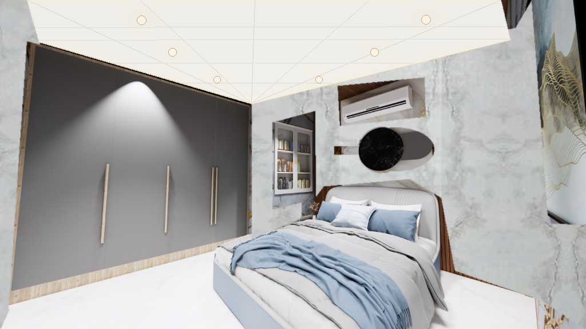
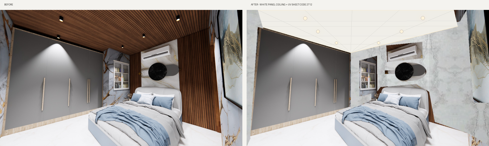

# UV Sheet Design Renders

Supplied room renders par UV-sheet options aur ceiling concepts apply kiye gaye hain. All generated images, references and reproducible Pillow scripts are included.

## Latest — Bedroom redesign

Bedroom ki visible walls par **UV Sheet CODE 2712** apply ki gayi hai. Wooden slat ceiling ko warm-white panel ceiling se replace karke perspective seams, six recessed warm downlights aur perimeter cove lighting add ki gayi hai.



### Bedroom before / after



## Living room — UV Sheet CODE 2712


### CODE 2712 reference

| Supplied screenshot | Extracted pattern |
|---|---|
|  |  |

## Previous beige/brown version


## Source renders

- `bedroom-source.png`
- `source-interior.png`
- `reference-stone.png`

## Recreate the edits

```bash
python -m pip install -r requirements.txt
python create_bedroom_code_2712_edit.py
python create_code_2712_edit.py
python create_uv_sheet_edit.py
```

Latest bedroom outputs:
- `bedroom-white-ceiling-code-2712.png`
- `bedroom-before-after.png`
