# UV Sheet Design Renders

## Bedroom ceiling panel colour samples

Attached bedroom image ki **sirf ceiling panels** recolour ki gayi hain. Fan, lights, walls, wardrobe, bed, floor aur baaki interior original rakhe gaye hain. Har option ek separate 1024×576 image hai; koi merged comparison image nahi banayi gayi.

**Best overall choices:** warm ivory room ko bright aur premium banata hai; ash grey balanced modern option hai; walnut existing wall panels ke saath sabse naturally match karta hai.

### Plain off-white VOX panel — new sample

Smooth off-white VOX finish with broad, subtle panel joints. Original dark wood grooves remove kiye gaye hain; fan aur warm ceiling lights retain kiye gaye hain.

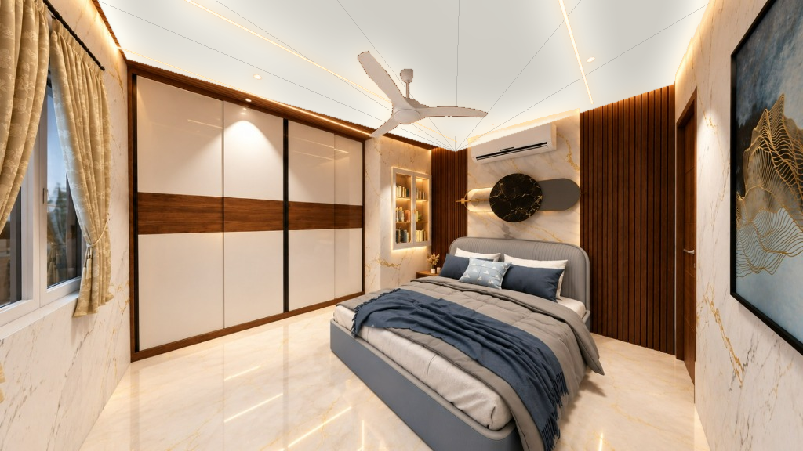

### 1. Warm ivory — light

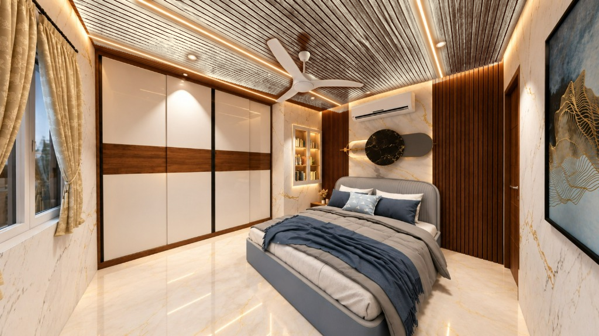

### 2. Natural oak — light

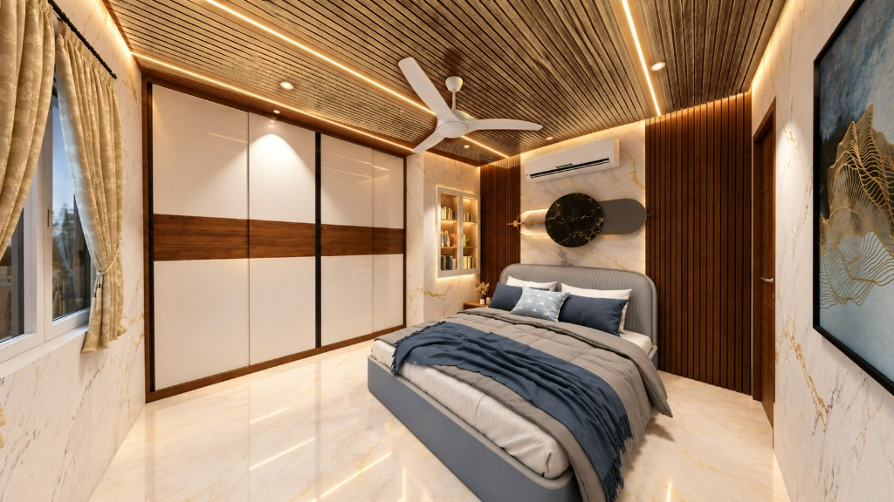

### 3. Ash grey — light neutral


### 4. Sage grey — medium

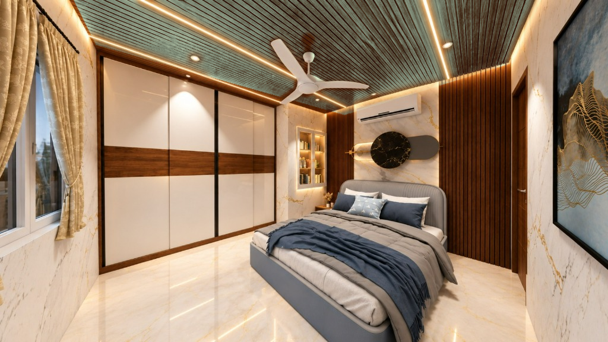

### 5. Walnut — dark warm

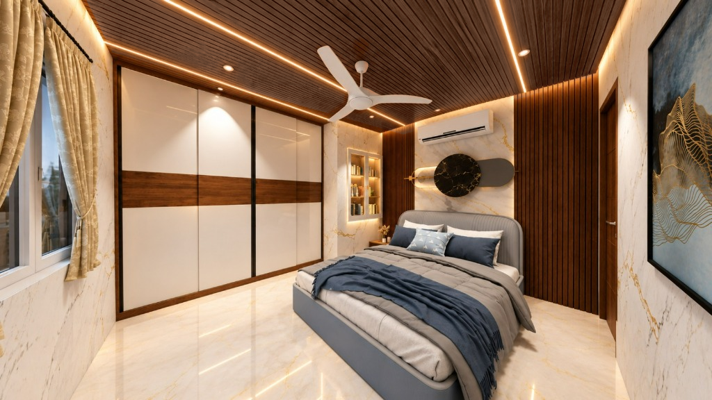

### 6. Graphite — dark neutral

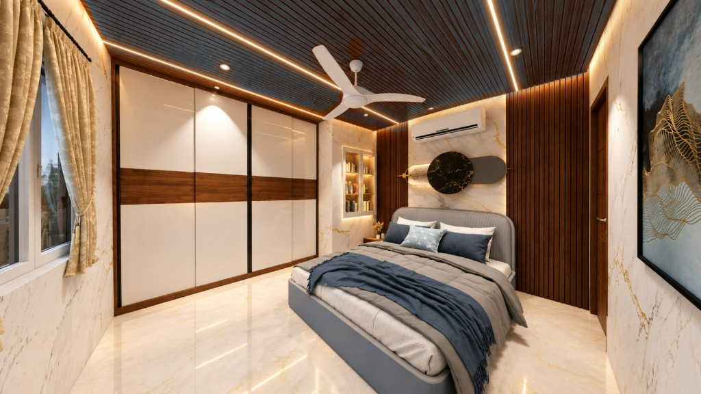

### 7. Midnight blue — dark cool

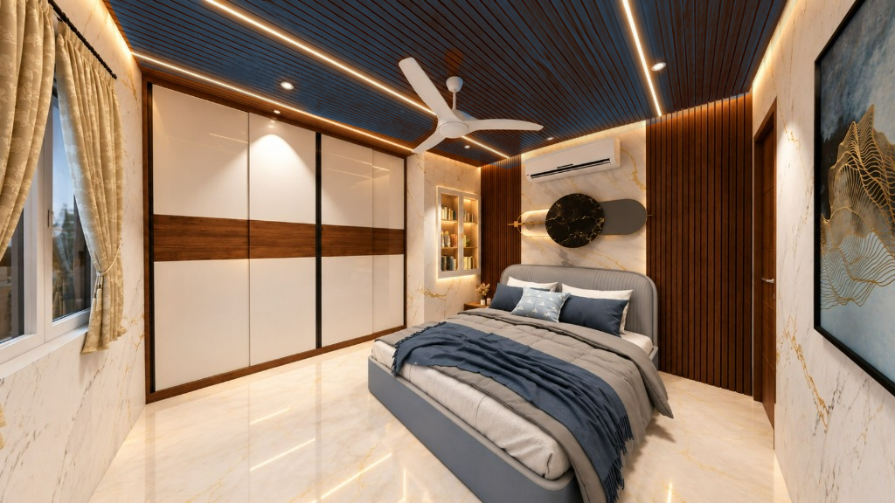

### Bedroom source

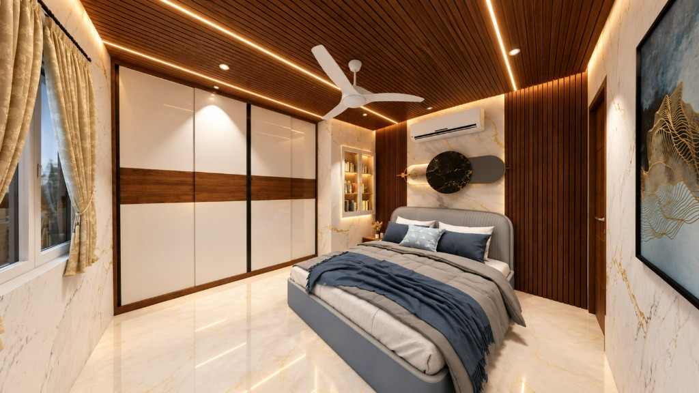

### Recreate the bedroom ceiling samples

```bash
python -m pip install -r requirements.txt
python create_bedroom_ceiling_colours.py
```

## Previous UV sheet renders

Living-room render ke UV-sheet areas par supplied product references apply kiye gaye hain. Ceiling strip lights aur spotlights ko warm cream tone diya gaya hai.

## Latest result — UV Sheet CODE 2712

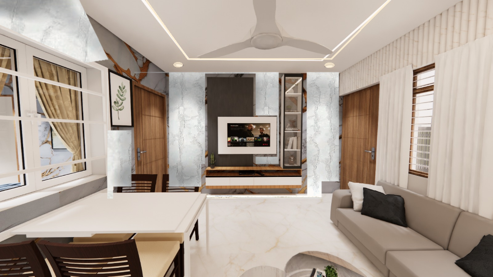

### Before / after

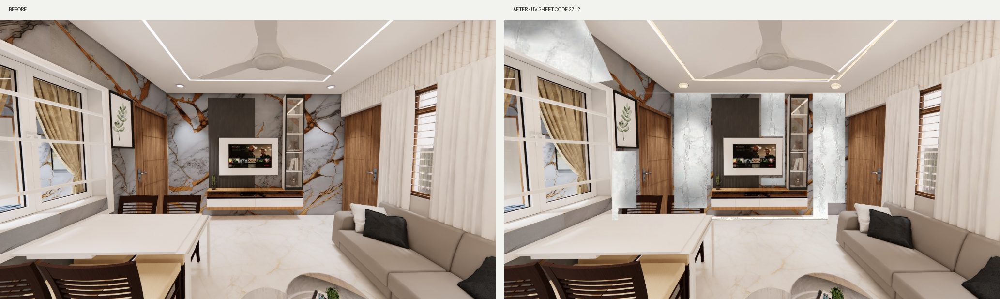

### CODE 2712 reference

| Supplied screenshot | Extracted pattern |
|---|---|
| 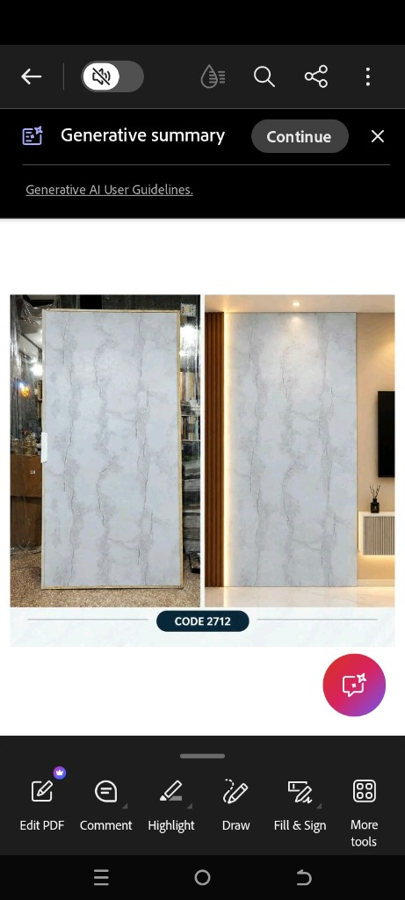 | 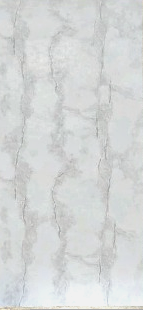 |

## Previous beige/brown version

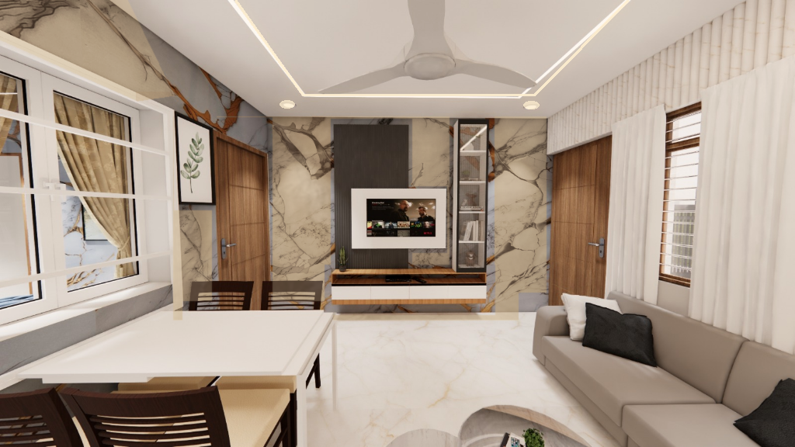

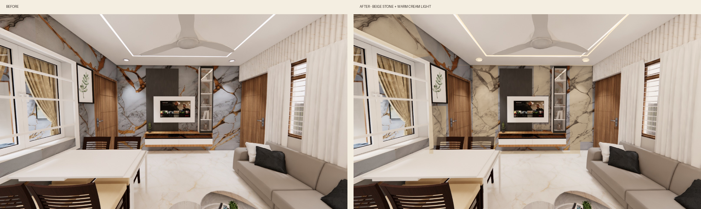

## Source files

| Original room | Beige stone reference |
|---|---|
| 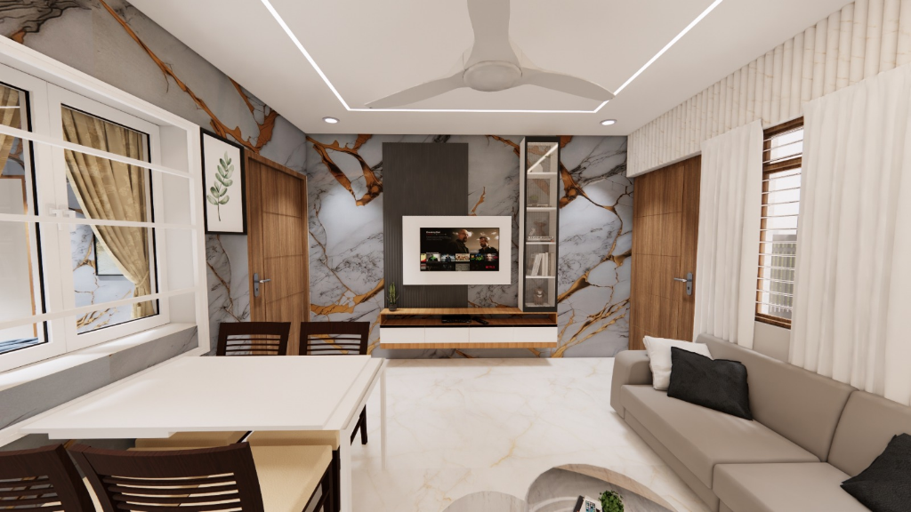 | 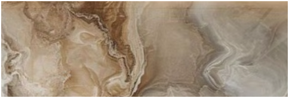 |

## Recreate the edits

```bash
python -m pip install -r requirements.txt
python create_code_2712_edit.py
python create_uv_sheet_edit.py
```

Generated CODE 2712 files:
- `edited-uv-sheet-code-2712.png`
- `code-2712-before-after.png`
- `code-2712-pattern-crop.png`
